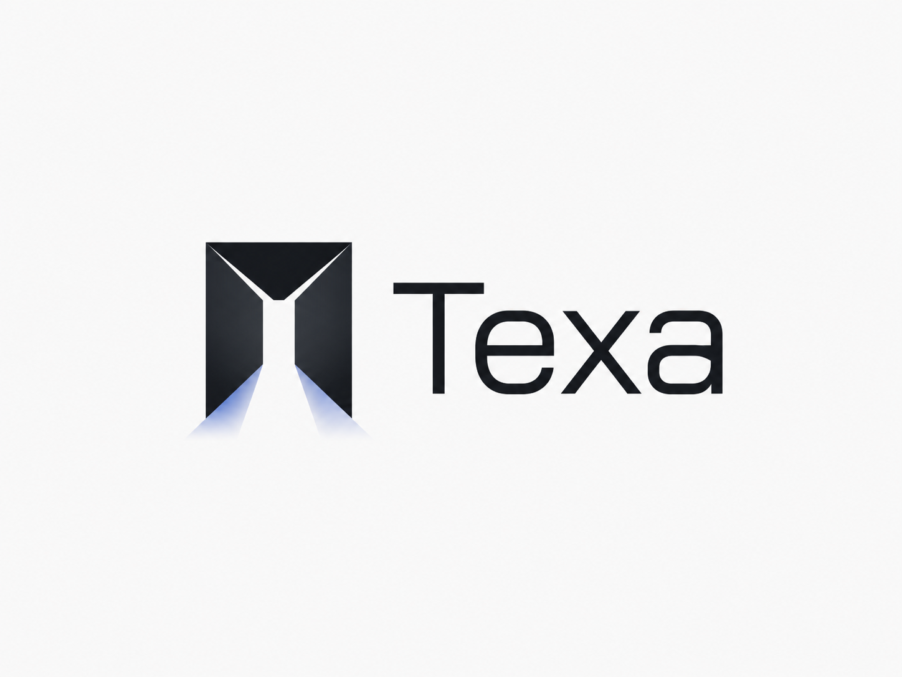
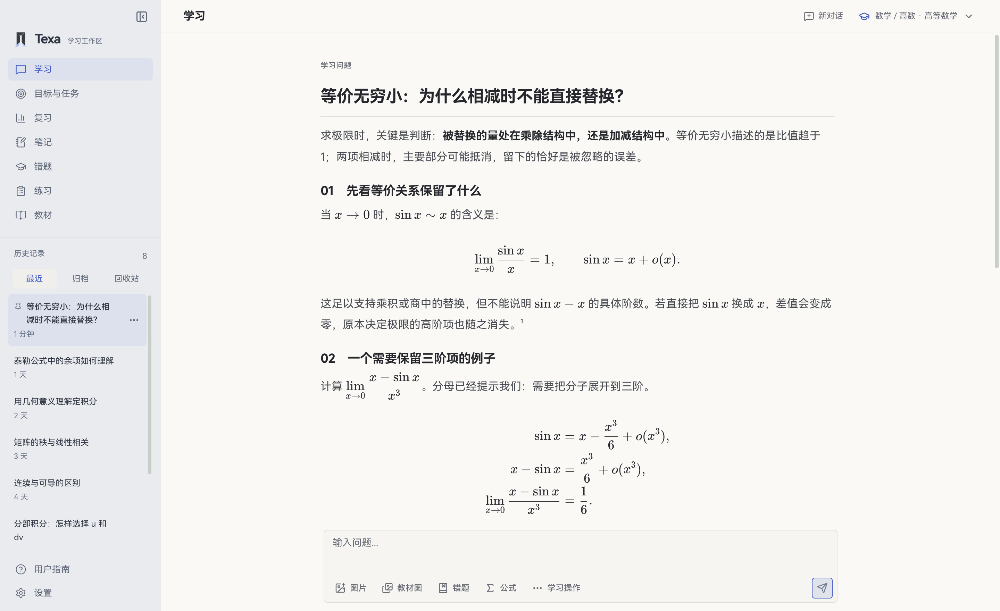
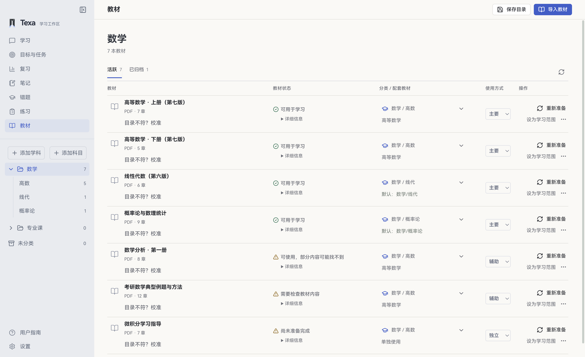
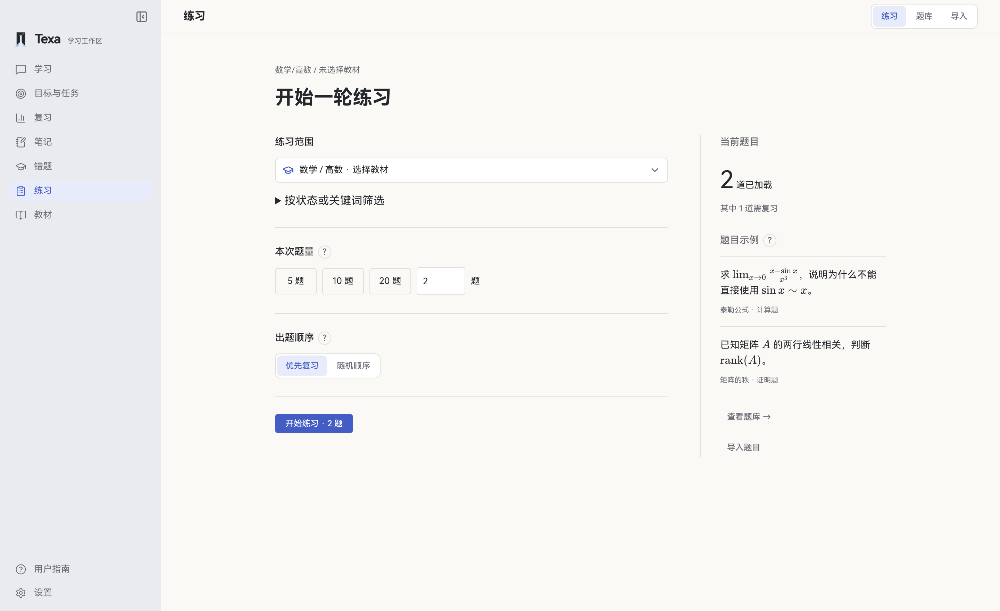
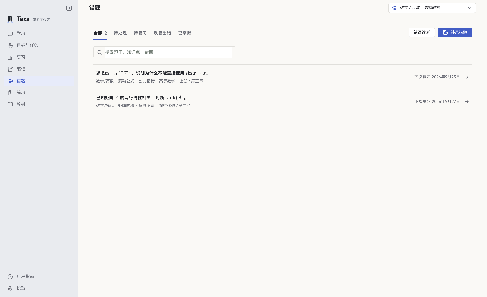
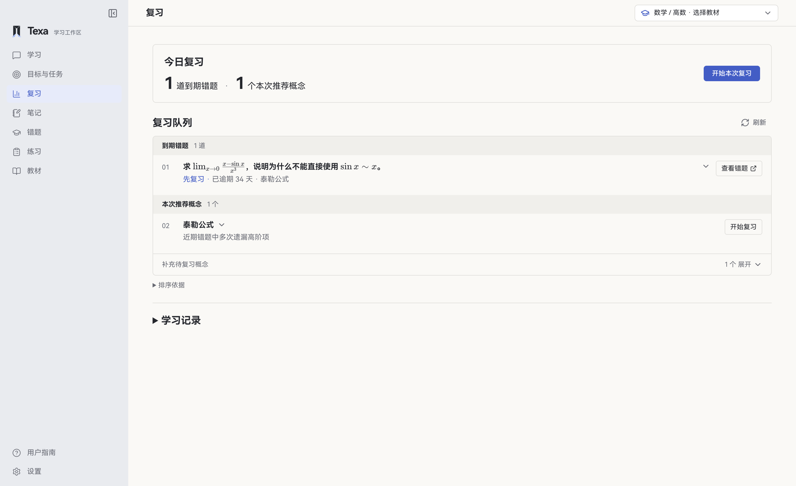
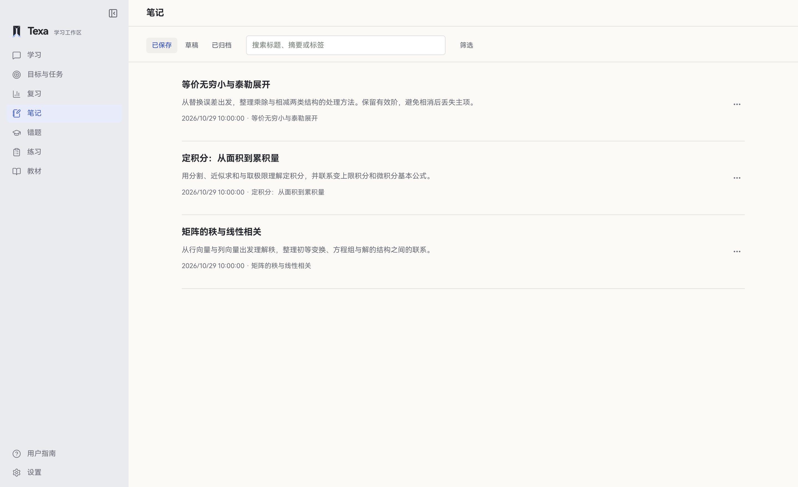
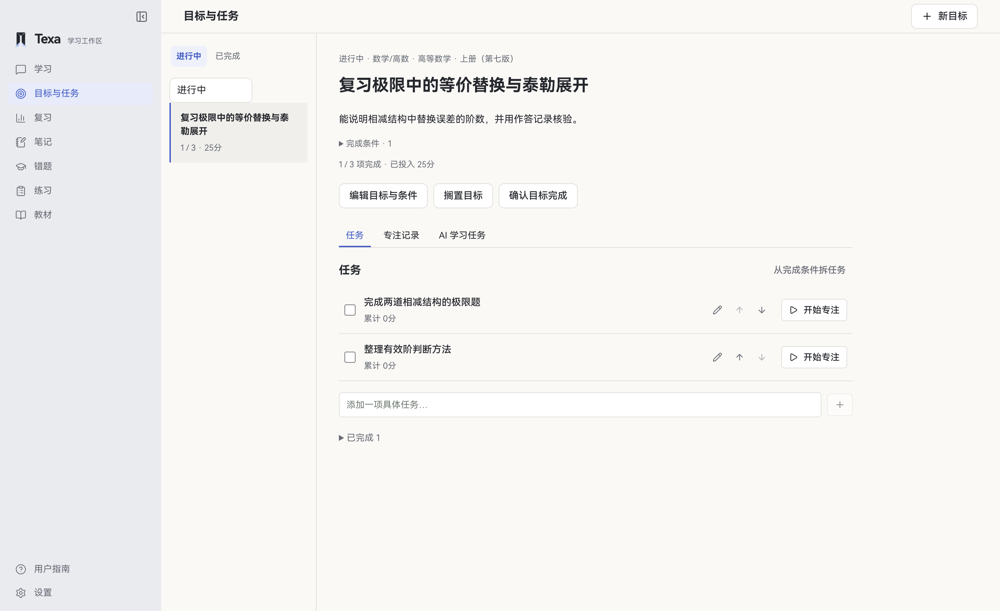

<div align="center">



# Texa

面向教材学习、练习与长期复习的本地桌面工作区

[下载桌面版](https://github.com/jayceto946-byte/texa/releases) · [快速开始](#快速开始) · [界面预览](#界面预览) · [使用文档](docs/user-guide.md) · [问题反馈](https://github.com/jayceto946-byte/texa/issues)

</div>

Texa 面向考研数学与专业课学习，将教材、对话、笔记、习题和错题放在同一个工作区。提问时回到教材，练习后保留作答，把值得复习的内容长期积累下来。

基于 **Electron + React + FastAPI**，支持 Windows 与 macOS 桌面运行。教材、索引和学习记录保存在本机；问答、识图和扫描件解析按配置接入模型或解析服务。

## 核心功能

| 学习环节 | Texa 提供的能力 |
| --- | --- |
| 教材与资料 | 导入 PDF 或 MinerU 解析包，按学科、章节和主要／辅助教材组织内容，支持目录校准。 |
| 问答与讲解 | 在选定教材范围内检索，结合来源片段回答；支持连续追问、图片题、LaTeX 公式和受控计算工具。 |
| 习题与错题 | 从文件提取候选题并人工校对，记录作答、答案和错因，关联教材与概念。 |
| 复习 | 通过间隔重复调度到期错题，结合概念接触与学习记录安排复习。 |
| 学习笔记 | 将会话整理为可编辑草稿，由用户明确保存；独立浏览、搜索和管理笔记。 |
| 目标与专注 | 自设学习目标，拆分任务并记录专注时间；关键操作由用户确认。 |

## 界面预览

学习工作区支持教材范围选择、对话历史、公式阅读与图片题输入。



<details>
<summary>教材库 · 分类、资料角色与目录校准</summary>



</details>

<details>
<summary>习题库 · 题目来源、校对与练习</summary>



</details>

<details>
<summary>错题本 · 作答、错因与复习状态</summary>



</details>

<details>
<summary>复习 · 到期错题与概念队列</summary>



</details>

<details>
<summary>笔记 · 保存与检索学习积累</summary>



</details>

<details>
<summary>目标与任务 · 学习安排与专注记录</summary>



</details>

截图来自 macOS Electron，窗口内容为 1440 × 880，PNG 原图为 2880 × 1760。页面内为演示数据，点击图片可查看原图。

## 快速开始

### 桌面版

当前已发布安装版：[发布说明](https://github.com/jayceto946-byte/texa/releases/tag/v1.0.1-commit.277.a187b6cd)。安装包已包含本地后端与所需运行环境，普通使用无需安装 Python 或 Node.js。

| 平台 | 下载 | 安装方式 |
| --- | --- | --- |
| Windows 10/11 · x64 | [下载安装器（EXE）](https://github.com/jayceto946-byte/texa/releases/download/v1.0.1-commit.277.a187b6cd/Texa-Setup-1.0.1-commit.277.a187b6cd.exe) | 运行安装器，默认安装到当前用户目录 |
| macOS · Apple Silicon（M1 及更新芯片） | [下载安装镜像（DMG）](https://github.com/jayceto946-byte/texa/releases/download/v1.0.1-commit.277.a187b6cd/Texa-1.0.1-commit.277.a187b6cd-mac-arm64.dmg) | 打开 DMG，将 Texa 拖入 Applications |

macOS 也可[下载 ZIP](https://github.com/jayceto946-byte/texa/releases/download/v1.0.1-commit.277.a187b6cd/Texa-1.0.1-commit.277.a187b6cd-mac-arm64.zip)。当前不提供 Intel Mac 安装包。安装包未签名，macOS 尚未公证，首次打开可能需要按系统提示确认。历史版本见 [Releases](https://github.com/jayceto946-byte/texa/releases)。

桌面更新与源码构建见 [桌面更新说明](docs/desktop-auto-update.md) 和 [macOS 构建说明](docs/macos_arm64_build.md)。

首次启动后配置回答模型；需要图片理解时，再配置视觉角色或多模态模型。教材可稍后导入。扫描件解析使用 MinerU，已有解析包可直接复用。

### 从源码运行

准备 **Python 3.10、Node.js 22** 和 Git，然后安装依赖：

```bash
git clone https://github.com/jayceto946-byte/texa.git
cd texa
npm ci --prefix frontend
npm ci --prefix desktop
```

<details>
<summary>macOS（Apple Silicon）</summary>

```bash
python3.10 -m venv venv310
venv310/bin/python -m pip install -r requirements.txt
./scripts/start-latest-desktop-macos.sh
```

启动脚本会构建前端，并由 Electron 托管本地后端。安装包构建见 [macOS arm64 构建](docs/macos_arm64_build.md)。

</details>

<details>
<summary>Windows（PowerShell）</summary>

```powershell
py -3.10 -m venv venv310
.\venv310\Scripts\python.exe -m pip install -r requirements.txt
npm run build --prefix frontend
npm run dev --prefix desktop
```

Electron 会启动本地后端。打包与部署见 [新机器部署](docs/new_user_deploy.md) 和 [发布与恢复](docs/release_security_and_recovery.md)。

</details>

模型连接可在应用设置中填写；环境变量配置可参考 [.env.example](.env.example)。日常开发与桌面集成使用 `Texa_MacOS`，`master` 作为仓库默认分支。

## 数据与模型

- 源码运行默认使用项目内的数据目录；桌面安装版使用 Electron 用户数据目录。备份与迁移见 [数据安全](docs/data_safety.md)。
- 推理与视觉角色可独立配置，也可由同一多模态模型承担；支持可配置的供应商和 OpenAI-compatible 服务。
- 使用远程模型或解析服务时，相应问题、图片或文档内容会发送到所配置的服务。凭据、本地教材和学习数据库不应提交到仓库。

## 开发与文档

```bash
npm test --prefix frontend
npm test --prefix desktop
```

后端测试使用 `venv310` 中的 Python 运行 `python -m pytest -q`。开发约定见 [AGENTS.md](AGENTS.md)，完整文档见 [文档索引](docs/README.md)。

| 入口 | 内容 |
| --- | --- |
| [用户指南](docs/user-guide.md) | 教材、学习、习题、错题和笔记的使用方式 |
| [系统架构](docs/ARCHITECTURE_HANDOFF.md) | 模块分工、运行边界与数据流 |
| [MinerU 部署](docs/mineru_deploy.md) | 扫描件解析服务配置 |
| [版本记录](docs/patch_notes.md) | 已完成改动与实际验证结果 |
| [发展目标](docs/texa-development-handoff-2026-10-06.md) | 后续方向、实施顺序与边界 |

欢迎通过 [Issues](https://github.com/jayceto946-byte/texa/issues) 反馈问题。界面问题请附上系统版本、Texa 版本与截图，分享前移除密钥和私人学习内容。
