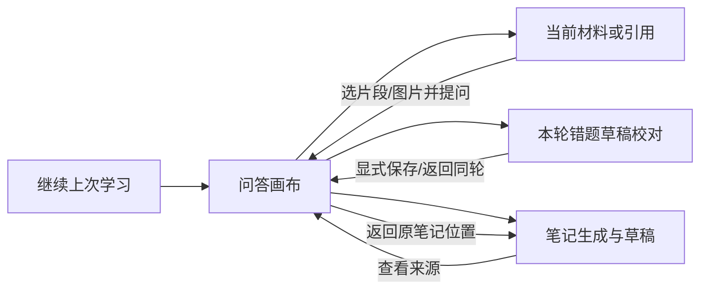

# Texa Mobile S2 — Experience, Performance & Reliability

审计与方案日期：2026-10-09（Asia/Shanghai）。状态：**设计提案，未授权实施架构调整；本轮未修改业务代码。**

## 决策摘要

S2 应首先让手机用户“随时回来，仍在原来的学习位置，知道刚才的操作到底有没有完成”，其次减少每次进入和切换所需的下载与往返。**不应把整个 S2 押在直连、自建中继或换协议上，也不宜先做完整的新移动首页。**

当前最大产品瓶颈是学习连续性：网络等待、连接拥有任务、内存中的输入和按功能分散的导航叠加，使一次离开容易变成重新找内容、重新确认任务甚至重新提问。最大可疑传输成本则是工作区字体、按 Blob 全量读取的教材 PDF，以及缺乏共享失效策略的数据读取。现有证据不足以给网络、模型、渲染各自分配百分比。

建议两周交付五项：①资源与请求减重；②回前台权威对账及首次响应丢失的稳定身份；③文本/笔记本地恢复副本与写回执；④当前学习内容的返回路径、引用和滚动修复；⑤真实弱网与双端闭环验收。连接断开仍中断的现有行为暂时保留，但要明确呈现并可靠找回。**连接无关的有限后台问答值得做，属于后续有条件的 S2 扩展，不塞入这两周承诺。**

移动信息架构应区别于桌面：以“当前学习上下文”为中心，Session 是连续性的载体，教材是材料范围，LearningTask 是执行状态。不要让用户先选择后端的 Task，也不要强制所有学习从教材或历史会话开始。继续复用 React、领域 hooks、Markdown/KaTeX、草稿/CAS、Session 和既有 Runtime。

Tailscale Remote 目前适合作为个人远程接入通道，**不能等同于随时可用的移动服务承诺**。桌面睡眠和校园链路限制无法由 UI 消除。先完成应用侧优化，再依据手机实际 SLO 决定中继投入；若仍长期不可用，应明确把产品定位收窄为“桌面在线时的移动伴随终端”，而不是继续堆叠加载提示。

---

## Part A — Current State Audit

### A1. 实际工作区与证据等级

本次入口 `/Users/jichengqian/Documents/ChatGPT/texa`，分支 `feature/mobile-remote`，HEAD `52cc1f5`；开始时 tracked/untracked Git 状态干净。S0 在 `9b04c87`，S1 和共享修复在 `4e8c3d4` checkpoint，随后是分支审计文档提交。没有 fetch、切分支、合并或重启当前服务。

本机另有 `codex/checkpoint-remediation@773c57f` worktree；**存在独立 worktree 不意味着尚未合并**。本次 `git merge-base --is-ancestor codex/checkpoint-remediation HEAD` 成功，历史有 `4687669 merge: checkpoint remediation into Texa_MacOS`。本地 `master@898bec3` 也不是当前移动代码。当前 refs 看不到 Windows 未推送/未提交的 Policy Model 工作；不能宣布所有设备分支已同步。详见 [分支隔离记录](GIT-BRANCH-ISOLATION-REPORT.md)。Sol 开始前必须重新核对 HEAD、工作树、相关分支祖先关系，尤其共享 `chat.py`、`mistakes.py`、Runtime、`client.ts` 和 `ChatPage.tsx`。

证据标记：

- **C：本轮源代码/本地测量确认**。说明实现事实，不自动意味着真机体验通过。
- **H：既有验收记录**。注明设备与范围，不把旧记录当本轮重测。
- **I：依据代码的推断**。需要性能 trace 或故障注入确认严重程度。
- **D：设计目标/待验证假设**。不是既有能力或性能保证。

用户已完成 S0/S1 的业务阶段；但仓库最后一份 [S1 记录](docs/validation/mobile-remote-s1/results.md) 仍把 Android 图片复测、错题和笔记正式保存闭环列为待验收。本文按“实现已具备，记录中的真机签收不完整”处理。如果之后已有线下签收，应补证据，不重复开发。

旧 [V0 Audit](Texa-Mobile-Remote-V0-Audit.md) 只作对照：远程 token 已改用 sessionStorage，已有连接页、上传前压缩、完整画面预览、图片题干资产继承、有限资源正文 deadline；不能沿用旧文档的缺失描述。S1 明确未实现上传图片联合教材 RAG；`book_name` 不等于存在教材证据。此差异仍有效，但不是本轮凭空追加的大型 RAG 项目。

### A2. 能力与缺口清单

代码定位以本次 HEAD 的路径和符号为准；行号用于快速查找，后续实现可能移动。

| 领域 | 现状与证据 | 判断 |
|---|---|---|
| 接入与首屏 | `frontend/src/App.tsx`、`RemoteConnectionGate.tsx`；`api/client.ts:14–60` 同源 `/api`、远程 sessionStorage token、401 失效事件；`desktop/main.cjs` 唯一后端/端口 | C：可复用。S0 使用全权临时管理 token，不是学习权限 token；日常发布仍需明确此边界 |
| 静态资源 | `backend/static_assets.py` 已对 JS/CSS gzip，hash 文件 immutable；`Workspace.tsx` lazy routes；`vite.config.ts` 保留旧 hash 产物 | C：不是完全没压缩/没缓存/没分包。保留旧资源尚无明确保留上限，需发布清理策略 |
| 工作区字体 | `frontend/src/index.css:3–25` 三个 Harmony TTF，`font-display:swap` | C：构建合计 24,647,436 B；I：首次进入有重大竞争下载风险。不是三个字体每次必下载；swap 只让 fallback 先显示，不消除下载成本 |
| 导航 | `AppRail.tsx` 七域；`MainLayout.tsx:19–62` ≤760 compact、<920 overlay、PersistentRouteOutlet；`Workspace.tsx` 的 `/books` 实际进入 `SystemHealth standaloneTab="subjects"` | C：教材入口是管理工作台，不是连续读书视图；手机复用了桌面领域目录 |
| 会话历史 | Sidebar 同会话跳过读取，其他会话读 `?limit=40`；`ChatPage` 有 before/after/message-context 游标；ChatContext 持有当前消息 | C：不是每次全历史下载。当前会话点击也不能替代跨设备刷新；换其他会话没有统一详情缓存 |
| 页面保活 | MainLayout Map 缓存访问过的路径，notes 共用一槽 | C：路由内返回较快且可保留流；I：大量错题详情路径累积可增加 DOM/内存，隐藏页并不自动停止所有 effects |
| 重复数据 | Sidebar、ChatPage 各在 mount GET `/books/list`；LearningPage 也读取；Sidebar 有 localStorage books 缓存，读时不检查 savedAt | C：有局部缓存但无共享去重、版本和有效期；不能概括为“所有页面没缓存” |
| 聊天 SSE | `api/client.ts:272` POST fetch 流；`chat.py:_chat_stream` 先发 context 进度再准备；no-transform / X-Accel-Buffering 已存在 | C：已缩短空白 TTFB。首 context 事件不代表 task 已持久化，亦非首正文 |
| 图片上传 | `imageProcessing.ts` 压缩全帧+工作图；XHR 上传百分比；`mistakes.py:825` 保存图后建 task；`ChatPage.tsx:453` 发送后清空输入/附件 | C：上传百分比不等于服务端接受。首 task 事件前断开仍难自动对账；未接受的照片没有耐久本地恢复承诺 |
| 图片回答 | S1 合并小 delta，首段立即，后续按 96 字/有新片段时约250ms，heartbeat/final 刷余量 | H/C：已经优化，不能重复列为新任务；不是独立计时器保证每250ms输出，更不证明模型变快 |
| 图片资产 | `visual_session_assets.py`、`mistake_chat_sources.py`、`tests/test_mobile_remote_s1.py` | C：完整题干/答案/图片可继承错题和 Notes 来源；大图“完整图片”是完整画面有损副本，不再保证相机原件字节 |
| 图片浏览 | ChatMessage 默认 task `preview=true`；`useAuthenticatedBlobUrl.ts` 按需鉴权 blob，关闭撤销 | C/H：已有 1280/JPEG78 预览。缺少跨组件、跨重开的有界资源复用策略 |
| 教材引用 | `ChatMessage.tsx:65–112`、`SourceGroupList.tsx`；FigurePageInspector | C：普通来源主要列书/章节/页码，不是所有 E-id 都有直接原文阅读动作；Figure 可看图和 PDF。不要承诺任意引用已能准确定位全文 |
| 教材 PDF | `FigurePageInspector.tsx:8–25`、ChatMessage FigureSourceDetail 先完整鉴权 Blob，再 iframe `#page=`；`useAuthenticatedBlobUrl.ts:46` | C：页面锚点不减少之前的全文件下载；当前调用没有 Range。即使服务端支持 Range，也不会自动使这个 Blob 路径按页读取 |
| 阅读滚动 | `ChatPage.tsx:184–205` messages 每次变化除特定定位/前插外直接 scrollTop=scrollHeight；正文 map 渲染 | C：流式更新可能把上翻用户拉回底部；I：长会话重复 Markdown/KaTeX 成本需 profile，未测帧率 |
| 笔记 | Notes 完整 turn 冻结、Job、草稿 CAS、正式不可变 revision；`autosave.ts` 800ms debounce 串行全 content PATCH；`useNoteEditor.ts` beforeunload/route flush | C：服务端已保存草稿可恢复，未上传编辑只在内存 retainedEditor；手机回收不保证 unload 完成 |
| 笔记请求 | `useDraftWorkspace.ts` preparing 每次响应后2秒再读；`useNoteDetail.ts` 编辑先 POST draft 再 GET；`NoteSourceInspector.tsx` Promise.all 来源读取 | C：有真实依赖链，也有已并行请求。不能把所有多请求都称为错误串行 |
| 保存幂等 | Notes DraftWorkspace op 存 useRef；错题 save 使用 `save-draft:id:revision`；后端已有 CAS/回执/来源去重 | C：无需重造同步引擎；刷新后 Notes op 不持续，未知结果应先查已保存草稿/回执，不能只重建 UUID |
| 任务恢复 | `owned_stream.py` close fence；`chat.py:1832` 状态 GET 适配 SQL/legacy；task resume/interrupt 已存在 | C：HTTP 流仍拥有 producer。task 状态可读≠浏览器已自动恢复，手动恢复≠从精确丢失 token 接续 |
| 事件 | `runtime_events.py:1` best-effort/content-free；`chat.py:1812` events 仅 SQL Runtime，delta 不持久化 | C：不能以 telemetry 回放替代答案恢复；终态完整正文应从 Session SQLite 读 |
| 请求身份 | useChat/ChatPage 客户端每次生成 turn；legacy `LearningTaskStore.create` UUID；SQL store 有 request_key UNIQUE，但 chat_binding 当前传服务端 request_id | C：底层有部分幂等机制，不等于所有 HTTP 入口按稳定 turn 幂等。未发现统一持久化提交回执/按 turn 找回合同；并发重复是否实际发生须故障测试 |

### A3. 七条核心用户路径

| 场景 | 当前操作/状态 | 摩擦与风险 | S2 产品方向 |
|---|---|---|---|
| 读教材时提问 | 教材管理/章节重点或 Figure → 选范围/图片 → 主聊天；没有统一通用 PDF 选文入题路径 | 书、章节、原页与问答位置断开；跨 iframe 选文不能假装已支持 | 先做已有章节/片段/Figure 的“带来源提问”，保留返回锚点；通用 PDF 选文延期 |
| 拍照解题 | 相机/文件 → 预览、可选裁剪/旋转 → 上传全帧+工作图 → 识图 → 解答 | 弱网上传慢；接受前清空附件；相机返回可能回收页面 | 默认全图可直接发，裁剪可选；本地待提交状态、可恢复输入、接受回执 |
| 看引用/公式/图片 | 回答 → 来源面板 → Figure 或 PDF；长公式横滚 | 来源常是位置清单；全 PDF 等待；读前文被流式滚动打断 | 来源在当前画布内展开，关闭回原句；优先已存片段/图预览，原页显式加载 |
| 收录某轮错题 | 用户问题更多 → capture → 草稿 → 校对/填作答 → save | 不是一键收藏；正确需要校对，但页面切换和返回来源不够统一 | 保留校对合同，将入口放该轮尾部动作；保存后返回同轮并标已收录 |
| 结束 Session 整理笔记 | 会话更多 → preflight → generation → draft polling → 阅读/逐块编辑 → 正式保存 | 步骤中有必要确认；长文手机逐块编辑重、保存响应丢失难判断 | 默认连贯阅读，点段落编辑；保留唯一草稿和 Job，显示本地/桌面草稿/正式保存的区别 |
| 错题/笔记返回学习 | 已有错题来源和 Notes live_locator 链接，ChatPage message context 定位，note_path 可返回 | 不是完全缺失；来源不可用、旧版本、正在回答时跳转仍需解释 | 复用现有 locator，不新造关联库；保留返回资产及滚动位置，缺源就读冻结内容 |
| 离开后继续 | route 内保活，localStorage 保存 conversation_id/subject；重开可从历史读；无统一 foreground reconcile | 当前 ID 不是“已恢复阅读位置”；锁屏/切网可能中断，输入/未保存编辑可丢 | 恢复书签+状态对账；结果未知不等于失败，禁止自动重发模型请求 |

操作步数必须用同一脚本实测；上表是控制流审计，不是假造的用户耗时统计。

### A4. 窄屏、组件与视觉证据

本轮实际查看了既有 `docs/validation/mobile-remote-s0/history-layout/phone-history-393.png` 与 `citation-reading/phone-reading-top.png`。前者显示功能导航占侧栏上半部，历史在下方；后者显示阅读层级。它们是旧夹具截图，**不是本轮最新真机截图**。S1 已修改问题字号，不能从旧截图推断现在仍大字。

源码确认已有 `100dvh`、composer safe area、公式/表格/pre 横滚、笔记窄屏换行与16px编辑框、IME composition 防误发送；S1 也已修正裁剪边界与24px手柄。仍需关注：

- 375/390/430px：范围、会话标题、恢复状态和输入区能否同屏清楚；不要再加常驻多行统计或底部七 Tab。
- Chat composer CSS 仍有14px规则；iOS 焦点缩放、软键盘、地址栏收缩、横屏和 MathLive 键盘是 D，不能以桌面 viewport 模拟通过代替。
- 源码存在24–28px教材管理按钮；裁剪手柄可视24px不应等同触摸命中区。设计目标常用操作命中区≥44×44 CSS px；紧密列表可通过透明 padding 保留密度。
- ContextInspector 在窄屏由外部 pointerdown 关闭，没有完整的手机返回栈合同。误触外部会否丢失位置需实测；不应让阅读内容、面板和 body 三层竞争滚动。
- 长表格要保留表意与横滚，不按列截字；长公式允许放大、复制 LaTeX，不强行折行矩阵；代码块独立横滚。页面整体不得横向漂移。
- 拍照需测 EXIF、密集下标、手写、横竖图及大图解码内存；已存在压缩不等于 OCR 无损。HEIC 目前明确拒绝并提示导出 JPEG，不承诺支持。
- 笔记保存状态在窄屏有压缩样式，但必须始终可读，不能仅以点/颜色替代；不同页面统一返回与状态文案，不重做品牌系统。

### A5. 本轮验证范围

| 检查 | 本轮结果 | 不代表什么 |
|---|---|---|
| Git 基线、祖先关系、关键源码/旧报告 | 已核对 | 未核对 Windows 本地现场 |
| Python | venv310 / Python 3.10.21；S0/S1、remote reads、static compression、chat reliability、mistake sources、session notes、runtime events 共 **102 passed / 6既有警告，3.30s** | 桩模型/合同，不是线上数学质量与手机可靠性 |
| 前端 | 当前依赖 Vitest **174 passed / 37 files，1.70s** | 没有自动化真机键盘/相机测试 |
| 构建 | Vite 8.0.16 临时输出 `/tmp/texa-s2-audit/build` 成功，保留大 chunk 警告 | 仅 Vite，不冒称本轮跑过 TypeScript、lint、Electron打包 |
| 视觉 | 重看两张仓库已有393px夹具截图；审读当前响应式代码 | 未新开生产 UI；未本轮真机、原生 Electron、Windows、iOS 验收 |

Python 测试设置 `ENV_PATH=/dev/null`，`DATA_DIR`、`PROGRESS_PATH`、`VECTOR_DB_PATH` 全在 `/tmp/texa-s2-audit`，关闭 bytecode/pytest cache。系统 PATH 无 npm，改用 Codex 已有 Node 直接执行本地 Vitest/Vite；未装依赖。没有真实模型调用、读取凭证、网络配置、业务库修改或覆盖 `frontend/dist`。旧记录的174/15前端/Electron通过不可代替本轮 Electron 实测。

---

## Part B — Mobile UX Redesign

### B1. 信息架构：围绕当前学习上下文，不围绕七个模块

三个候选中心的取舍：

| 中心 | 优点 | 不适配之处 | 结论 |
|---|---|---|---|
| 教材 | 范围清楚，适合章节学习 | 拍照、错题复习、已有笔记不一定先选书 | 作为材料入口和范围，不作强制首页 |
| Session | 已有完整历史、turn与资产来源；切换成本小 | 会话不应吞并独立笔记/错题，也不应成为长聊天列表的唯一视图 | 当前学习的主要连续性载体 |
| LearningTask | 能表达执行与恢复 | 用户想读书/看笔记时不需要先创建任务，且无任务不意味着无学习 | 执行状态附着于内容，不作导航中心 |

推荐“**当前学习画布 + 按需学习切换器 + 当前材料视图**”。手机顶栏只放返回/学习切换、当前标题、一个必要状态和更多；输入区保留拍照、文字/公式、发送。阅读时底部是当前材料/返回问答的轻动作，键盘展开时只保留输入动作。不同组件使用同一份范围和返回定位数据。

学习切换器优先展示最近 Session、正在整理的草稿、当前教材/章节；再提供错题、笔记、教材的明确文本入口及到期复习入口。目标/统计/导入管理仍可访问，放次级“更多”。这不是把三个数据库合并，也不新建“学习上下文”后端业务实体。

不默认采用底部 Tab：Texa 的读书→问答→查来源→整理笔记是同一任务内切换，底部并排七域会遮住输入和内容，还不能解决返回位置。第一版选择上下文切换与明确返回；如果真机任务测试证明用户频繁找不到资产入口，再比较“学习/资料”双入口，不能只凭偏好定导航。

### B2. 关键交互状态

**问答 ↔ 材料：** 第一次打开材料显示可用片段和来源位置；未取得资源时保留回答，不覆盖成全屏加载。手机采用可全屏展开的材料层，短片段可局部展开，关闭/系统返回先回原回答锚点。大图/原页加载失败仅影响材料层。选片段进入输入附件条，显示范围、可移除，不自动提交。切换教材是显式的新问题范围操作，不能由目录刷新重置已有会话。

**引用状态：** `位置已知`、`已有冻结片段`、`正在读取图/原页`、`不可用/版本不匹配`。旧引用缺 snippet 时明确“只有来源位置”，不从新索引悄悄补出看似原证据的正文。优先沿既有 E-id、IR/heading、index版本定位；不能仅靠页码/章节标题匹配。

**拍照状态：** `本机选图` → `本地处理` → `待发送` → `上传字节进度` → `桌面已接受(task)` → `识图` → `待补材料/生成` → `终态`。压缩失败不偷偷改传大原图；前台等待可收起照片预览。100%只表示浏览器发出，必须等待接受回执。上传未确认且切后台时保留文本和图片引用/恢复副本，不引导“再拍一次”。

**错题状态：** 收录动作始终作用于明确 turn；复用已有 capture 来源去重。打开同一草稿显示图、题干、已有解答和待填写的实际作答/错因；校对后正式保存。`请求未确认`时禁用新 operation，不把按钮改成“再添加”；保存成功在原轮显示已收录及打开入口。不取消人工校对以换取少一步。

**笔记状态：** Session更多里的整理动作保留 preflight 的范围/不完整turn判断；生成是既有后台 Job，离开再回来查看同 draft。默认文章式阅读，点一段进入局部编辑，编辑和阅读共用滚动锚点。状态文字区分“仅保存在此手机”“桌面草稿已保存”“已保存为笔记第N版”；正式提交仍显式触发。不强制展示逐块来源、核实徽章或额外确认警告。

**恢复状态：** 重开先恢复位置和本机草稿，再查询桌面；历史内容可以标“上次读取”先显示，任务按钮必须按新权威状态解锁。回到错误旧页、失效凭证、后端重启应保留用户输入，而不是自动清空。

### B3. 组件复用与改造边界

| 保留 | 手机变体 | 需要改变的交互 |
|---|---|---|
| ChatContext 的领域身份、history cursor、resume/stop、错题/Notes hooks | MainLayout 顶栏/学习切换器、ContextInspector 全屏阅读层 | 七域侧栏不再承担所有高频跳转；当前范围/返回位置显式共享 |
| MarkdownRenderer、KaTeX、引用编号/验证、Figure/受控图接口 | 公式放大、触摸菜单、引用短片段/原页模式 | 不再每次 delta 强制拉到底；不靠缩小字体容纳桌面布局 |
| ProblemImageEditor 压缩/旋转/裁剪、后端图存储 | 手机命中区、默认全图、处理状态 | 避免强制先裁剪；发送前清空改成“接受后释放待提交资产” |
| Notes CAS/串行 autosaver/正式 revision、错题草稿 | 局部段落编辑、固定可见保存状态 | 内存 retainedEditor 补本地恢复副本，不发展为另一权威库 |
| 已有 note_path、message locator、source return | 共用受控返回描述符 | 从资产回来不用重新找历史列表；来源失效保留冻结内容 |

手机差异通过 viewport/输入能力和明确的 compact variant 控制；远程浏览器不一定是手机，Electron 760px也不一定需要完全相同移动导航。领域状态不复制。桌面1280×820、1024×768与760×820分别验收，保留既有视觉参考、主题、快捷键和窗口拖拽区域。

### B4. 阅读与输入验收目标

1. 在375/390/430px、系统字号100%和放大条件下，范围/任务门槛/发送或保存动作可操作，无整页横向溢出；公式、表格和代码可在自身区域横滚。
2. 输入法展开、收起、相机返回、浏览器栏变化后，最后编辑位置与发送按钮可见，safe area 不与软键盘高度重复叠加。不一开始引入全局 VisualViewport JS 补丁；仅对真机复现的遮挡补偿。
3. 用户上翻后流式更新不夺取阅读位置；提供“回到最新”，仅用户已贴底时跟随。历史前插保持 message ID/相对偏移，而非仅依赖像素总高。
4. “引用→回原句”最多两次显式操作；“从笔记看来源→回原笔记段落”保留同一 revision/编辑副本；“读当前片段→带片段提问”不超过三次操作（不计输入文字）。均为 D，执行前录同脚本基线。
5. 长 Session 先使用现有分页和问句定位；100轮夹具测 render/scroll，再决定 windowing。优先 memo 已完成消息，不直接虚拟化带动态公式高度的整棵消息树。

---

## Part C — Transport & Performance

### C1. 不把 RTT、吞吐、模型时间混为一谈

用户提供 DERP(lax) 约396–1291ms背景。本地 S1记录包含1049/396/443ms及后续438/444/428ms；一次普通Wi-Fi对照曾 direct≈79ms，但不能沿用为稳定直连。网络记录还显示某次 Mac UDP 可用，不能把校园网、手机热点、普通Wi-Fi三组证据混成“校园网禁UDP”的结论。

粗略分解（不是精确预测）：

`可见结果时间 ≈ 连接建立 + 关键依赖链上的请求等待 + 上传/下载字节时间 + 服务端排队/检索/模型时间 + 解析/布局/绘制时间`。

复用连接后的一次小 GET 通常包含应用请求往返，但不必等于 tailscale ping；DNS/TLS、代理、丢包重传、拥塞、服务端CPU及正文大小都会改变结果。连续SSE不会为每个token重新付一次RTT。四个不必要串行GET在400ms路径上，仅往返项就可能约1.6s；这只是数量级假设，HTTP并行、缓存和实际RTT会改变结果。

1.25MB图片在有效上行1Mbps时纯字节约10s，在0.25Mbps时约40s，尚未计重传/握手。一次S1服务端任务约67.3s，其中识图约15.5s、最终1732字；这说明模型时间确实存在，不能把约两分钟用户等待全部归因DERP。历史同会话本机约10ms与手机20s响应头超时只是跨路径线索，不能作根因证明。

### C2. 已做优化与下一步实质差额

| 层次 | 已有 | S2新增最小动作 | 不应做 |
|---|---|---|---|
| 启动/静态 | 轻连接页、工作区lazy、gzip、hash immutable | 远程手机默认系统中文字体或可选加载；保留数学字体；确认首屏真实依赖链与旧资源保留策略 | 再把“开启gzip/懒加载”当新成果；未测就全站打成一个包 |
| 数据访问 | 40消息分页、Sidebar books局部缓存、页面保活 | books共享single-flight；最近3个Session页内存LRU；notes读版本缓存；回前台更新 | 全量持久化所有会话/教材；缓存失败响应；缓存命中后悄悄改教材范围 |
| API | 有状态GET、cursor、CAS、局部聚合 | 状态/版本小响应；按需聚合恢复信息，主体失败与辅助失败分离 | 创建一套 `/mobile/*` 镜像API；把所有入口都改成大bootstrap |
| 图片 | 双图压缩、上传进度、轻预览 | 已接受资产复用；同图/同变体内存Blob复用；按需原尺寸 | 继续无限降低分辨率来掩盖网络，丢公式细节；首屏自动拉原图 |
| 教材 | Figure、小片段/来源定位、PDF接口 | 先片段/已有图；若原页高频再做受控单页预览；显式提示全PDF加载 | 给Blob URL加`#page`便宣称按页传输；全书后台预取 |
| SSE | context首事件、图片delta合并、canonical边界/fence | 记录首接受/首正文/间隔；UI按帧或50–100ms聚合delta，终态立即flush | 替换WebSocket；gzip缓冲SSE；每token刷新整个历史 |
| 渲染 | Markdown/KaTeX、局部横滚 | 完成消息memo、贴底跟随、按需执行记录、隐藏页暂停无关轮询 | 未测就上全量虚拟列表、Web Worker重写渲染 |

构建实测（独立产物，不是手机请求总量）：index JS 20,661B；Workspace JS 31,604B；Workspace CSS 170,570B；ChatPage JS 95,303B；mathText JS 392,724B；mathlive动态块801,135B。MathLive已有动态import，不应因为包大便判断它堵住首屏。Harmony三个文件分别8,261,128 / 8,227,312 / 8,158,996B；静态压缩中间件只显式处理JS/CSS，须实际测TTF响应，不假设字体已gzip。连接页旧记录约73.6KB gzip并不等于登录后学习工作区总成本。

**优先假设：手机系统字体使冷启动不请求这些TTF，可消除最多约24.6MB的潜在下载；实际节省以waterfall为准。** 桌面字体/主题不改。若用户需要阅读字体，设明确选项/按需资源；后续才评估子集化WOFF2及许可证，不把字体流水线建设塞进首周。

### C3. 请求链的具体设计

- books：一个共享读仓库负责正在进行的Promise和最后成功快照，key包含桌面数据源身份/权限代次；Sidebar与ChatPage复用。同一失效代次最多一次读，`books:changed`触发一次失效。已有localStorage不带权威版本，先标快照再校验；不重置会话。
- Session：首次依然分页读，切回最近页先显示快照、保留anchor，再按最新seq/管理revision验证。停止/恢复按钮等副作用依赖fresh task；内容旧不等于仍可写。消息更新事件和最终投影可能更新原消息，不能只按数组长度判断新旧。
- Notes：不可变 `note_id+revision` 阅读内容可内存长缓存；“最新revision”必须验证。现有PATCH携带完整content，可先调连续编辑debounce到约1–1.5s并保持单flight/max-wait，网络saving期间不清dirty。只有测到长笔记上传占主导再加block级patch；base revision与冲突规则不变。
- Blob：LRU按资源ID、版本、preview尺寸和鉴权代次；控制总字节，引用计数释放objectURL；token失效清理/锁住资源缓存。先用内存，避免Service Worker误缓存私人API。
- 恢复：优先既有task GET与Session cursor并行；首次task未知才加小型submission lookup。若实测多跳显著，可增加单个恢复聚合用例，返回身份/状态/next cursor，非整个历史和教材。建议压缩后≤20KB；status-only≤4KB是验收预算，不是目前大小。
- 预取：用户已选择当前材料、已打开学习切换器时预取一个最可能进入的小对象或页面chunk；后台/上传中/弱网时暂停。不要并发拉全教材图，抢占上传和答案通道。缓存最新修订失败可显示旧阅读快照，不能伪造保存成功。

现有 source Promise.all、Notes list/filter并行应保留。POST draft后GET草稿是有因果依赖的链，可用POST返回已具备的草稿直接初始化，后台再校验；若创建响应只有ID才评估加所需数据，不能删掉业务校验。`authenticatedHtmlBlob` 会等待所有子图Promise后才展示HTML，长页可先文字后按需图，是素材浏览性能的后续候选。

HTTP连接复用由浏览器/Serve/后端协作；同源已有优势。测 `nextHopProtocol`、连接建立次数和并发阻塞，不能从`Connection:keep-alive`推断已端到端HTTP/2。是否需要调整代理HTTP配置必须由waterfall证明，S2不新建协议层。

### C4. 测量合同与目标

新增观测只记尺寸/耗时/阶段/构建与匿名关联ID，不记token、正文、题图、模型prompt。服务端已有 `RemoteReadOptimization` 的Server-Timing是到响应头的应用耗时，不是模型耗时或端到端下载。图片上传、首task持久化、首正文、final落库需分开计时。

| 指标 | 起止与方法 | D：初始目标 |
|---|---|---|
| FCP/LCP | PerformanceObserver，冷/热分别记录 | 冷连接页FCP p75≤2.5s；正文加载另计，不能只拿连接页获分 |
| 可用学习画布 | navigation→最近Session可读且输入可响应；补long-task/INP | 受控400ms RTT、5Mbps下行/1Mbps上行：冷p75≤5s，热p75≤2s；INP p75≤200ms；第一天校准 |
| 发送即时反馈 | tap→本地问题与“等待桌面接收” | p95≤100ms；不是服务端接受或任务完成 |
| 服务端接受 | tap→持久化身份回执；单独扣出上传时间 | 小文本受控网络p95≤2s；模型首token另计 |
| 流式连续性 | 服务端产生delta→客户端paint；前台间隔/长任务 | 本地渲染附加p95≤100ms；无末尾丢字。模型停顿/网络停顿分别标记 |
| Session/笔记切回 | click→缓存正文首paint，后台校验另计 | 热缓存p95≤200ms；未缓存不承诺200ms |
| 本地编辑 | input→绘制；本地备份完成→提示 | p95≤100ms；保存中继续输入不回滚；正式成功仅服务端回执后显示 |
| 图像 | 字节数、处理/上传/接受/识图/首正文分别测 | 维持S1约1MB数量级而非盲目更低；清晰度样本关键条件无新增缺失 |

TTI可在诊断工具里保留，但不作为唯一可用性指标；本项目以“画布可读且可输入”业务标记与INP/long task补充。LCP表示主要内容可见，与真正可交互不是同一概念。[LCP官方说明](https://web.dev/articles/lcp)

受控网络另设800ms±200ms抖动、1Mbps下行/0.25Mbps上行，及连续断开10/60秒。该档不承诺5秒冷打开，验收重点是已有内容可读、没有假完成、无重复任务、恢复有界。浏览器限速不能等价模拟VPN丢包/切路；另用真机DERP实测。每场景至少5次冷启动、20次热交互，报告原始范围和p50/p95（小样本p95只作观察），不使用跨时钟直接相减制造服务耗时。

### C5. 网络路线与退出条件

| 路线 | 前提与真实收益 | 成本/约束 | 决策 |
|---|---|---|---|
| 继续官方DERP+Serve | 不改部署，先改善应用资源与恢复 | RTT/吞吐仍不可控 | 两周默认，记录真实手机路径 |
| Direct诊断 | 分别检查两端UDP/NAT、热点与普通Wi-Fi/蜂窝；比较同一HTTP样本 | 不能保证校园允许，不能以开放防火墙代替诊断 | 最多半天只读探测；不阻塞应用工作 |
| Peer Relay | tailnet第三节点、两端到该节点UDP可达、客户端版本及grants符合要求 | 常在线机器、端口/ACL、地区带宽；不解决完全UDP不可达 | 有现成机器时优先限时试验 |
| 自建DERP | 选两端实测都较好的节点，仍保持tailnet与应用鉴权 | TLS/证书、升级、带宽、监控、访问控制；不是换近机房就一定快 | Peer Relay条件不满足且应用优化后仍失败再审批试点 |
| 第三方托管中继/反向隧道 | 实际路线可能更好 | 信任、可用性、凭证、日志与维护边界改变；TLS终止方案需单独审计 | 不把未知免费服务写成生产推荐；不默认启用Funnel/公网后端 |
| 原生App/换VPN控制平面 | 不能消除物理路线与桌面睡眠 | 大量新维护面 | S2不做 |

截至本次查阅，Tailscale官方：Peer Relay参与端要求1.86+、配置可达UDP端口及授权；可用时先尝试peer再回DERP。官方也建议频繁DERP性能不足时通常优先Peer Relay，而非自建DERP。这里仅用于路线筛选，不宣称当前校园条件满足。[Peer Relay](https://tailscale.com/docs/features/peer-relay)、[DERP](https://tailscale.com/docs/reference/derp-servers)

DERP由Tailscale连接机制选择，Texa内不做“强制LAX改某节点”开关。Serve是HTTP入口，不是另一种加速中继；exit node也不是默认的peer路径加速器。[连接类型](https://tailscale.com/docs/reference/connection-types)

路线试验用同一手机、同一桌面、固定只读payload与上传夹具、相近时段，记录direct/peer/DERP、HTTP TTFB、正文完成、有效吞吐、切网恢复。**候选基础设施只有在至少三个不同时段的p95核心操作改善≥30%、中断率不增且维护可接受时才保留**（D）。若优化后两天日常使用中小读请求仍频繁20秒超时、图片上行仍超过用户可接受的几十秒，应先做路线/定位决策，不继续把应用超时无限调大。

---

## Part D — Reliability & State

### D1. 分开连接、执行、保存三种状态

UI至少三轴：`连接：可达/重连中/不可达/需重新认证`；`执行：未确认接受/运行/等待输入/等待确认/中断/失败/完成或degraded`；`编辑：仅本机/桌面草稿/正式版本`。这些是展示投影，不新增第二套Runtime状态权威。

没有收到final时，网络断开只能说明“结果未确认”；不能直接宣布任务失败、也不能把已经显示的部分正文替换成错误字符串。当前useChat及图片错误回调确有替换content的路径，S2应保留partial并附上对账状态；权威重读后再替换为完整最终内容。

| 环境事件 | 目前可保留/丢失 | 最小恢复行为 |
|---|---|---|
| Wi-Fi↔蜂窝、Tailscale切路 | TCP可能继续、停滞或断开；offline事件不覆盖所有情况 | 网络事件只是触发器，回前台合并一次只读probe与task/session reconcile；不重发POST |
| 锁屏/后台 | 浏览器可能冻结，现有流断开会fence；尚未上传的编辑在内存 | hidden尽力写本地恢复副本；visible/pageshow重新读权威，hidden本身不当作用户停止 |
| 桌面睡眠/退出 | 已持久化数据仍在；不可服务，运行是否已中断须后续确认 | 显示桌面不可达/状态未确认；不无限spinner，不承诺远程唤醒 |
| 桌面重启 | 现有启动恢复合同、token/端口可能变化 | 新实例鉴权、版本校验；旧run不得接管；未完成标可解释中断，不自动付费重跑 |
| 刷新/进程回收 | 服务端草稿/历史仍在；内存输入、File、retained editor与op ref可丢 | 先恢复本地journal/locator；查询旧身份；照片未保全须如实提示重新选择 |
| final响应丢失 | 服务端可能已完成投影 | task终态+Session消息找到结果，0次新增模型调用 |
| save响应丢失 | 已有后端幂等能力，但客户端操作身份可能丢 | 原operation_id或已保存draft回执对账，不能另建正式资产 |

移动浏览器hidden/frozen/discarded不保证最后执行unload；beforeunload不是耐久保存机制。需要在编辑过程中持续做轻备份，后台信号仅补一次尽力flush。[Chrome Page Lifecycle](https://developer.chrome.com/docs/web-platform/page-lifecycle-api)

### D2. 最小恢复协调器

放在现有前端应用/feature层，协调既有接口，不建移动Runtime：

1. 每次用户发送前持久化一个小型submission记录：客户端submission/turn ID、conversation ID、类型、范围、规范化payload hash、创建时间、已知task/run；凭证不写入记录。文本恢复副本单独有界存放。
2. visibility→visible、pageshow、online、transport error和手动“检查状态”进入同一single-flight对账。给当前连接代次编号；旧请求返回不得覆盖新代次。短时间重复事件合并，后台停止无关轮询；前台未知状态可按2/4/8秒退避到30秒，恢复后重置，不每页各自poll。
3. 已知task时查询现有 `/chat/tasks/{id}`；并行读取对应Session增量/定位消息。完成且投影已确认则展示完整正文；中断仅在服务端resumable时提供继续；等待输入返回原task补材料；运行则显示运行而不重复恢复；权威已完成但投影缺失显示“结果待同步”，走既有effects恢复合同，不重新推理。
4. task未知时按稳定submission/turn找回。当前没有统一可依赖的此类查找合同，需补服务用例，覆盖legacy、SQL、visual，不通过扫全部历史/全部文件作为长期方案。
5. 全部事件按task/run/seq及前端选择代次隔离；用户已换会话时旧response只能更新该task缓存，不能调用updateLastMessage写入另一会话。只靠isLoading禁按钮无法约束另一个设备。

`navigator.onLine`只能作提示；401先重认证，403权限不足，404身份不存在/来源删除，409冲突，5xx或超时结果未知分别处理。只读重试可有界进行；模型启动、resume、save不得统一自动重试。读取超时20秒、资源60秒、图片流6分钟与后端单次reasoning420秒目前不一致：先定义上传/无活动/总任务deadline语义，终止网络等待不等于取消执行，超时转对账而非再次提问。不要仅把6分钟改为更大数。

### D3. 稳定接受与去重：必须补齐的服务合同

推荐复用客户端既有conversation/turn，增加稳定submission identity和payload hash。**已有SQL request_key可复用但当前入口每次生成request_id；legacy UUID create也没有此项保证。** API服务层统一接收/查询合同，具体执行仍走原路径。

- 接受键限定同一数据源、conversation、turn和操作类型；重试必须同payload hash，不同payload返回明确冲突，不能以相同turn替换题目。
- 原子准入保存“正在接受/已绑定task/未完成接收”的回执，task创建与回执绑定要防崩溃窗口。不能先响应202再只在内存登记；不能把JSON写与SQL写假装成单事务。
- 实现选择：优先核对现有conversation SQLite幂等元数据/回执能否扩展；如需新表，只做窄submission映射，设计迁移/回滚并依AGENTS申请实施批准。不为此迁移全部LearningTask到SQL。legacy需确定性task绑定或可恢复二阶段回执；启动时不确定接受状态只对账，不自动模型运行。
- 同Session两个不同turn并发是否允许必须统一。推荐S2仅一个活跃回答：事务/共享准入栅栏返回现有task，让另一端看运行状态；不要在第二端自动停止第一端。归档/回收站栅栏、Goal origin、旧run fence仍保留。该约束要覆盖文字/图片/Figure/SQL分支，不能只保护一个Router。
- multipart接收可能在task创建前就断；找不到回执不自动等于“从没上传”。查询必须可区分接受中与确定未接受；人工重试使用同identity并受原子准入约束。未绑定的临时图按既有生命周期清理，不移除已被task引用资产。
- 恢复命令也应有稳定operation key和expected run，重复点击不创建两个恢复run；跨设备停止必须指向当前run。

这项复杂度比UI小修高，是两周最主要工期风险。若第二天合同审查发现跨存储原子性无法在预算内验证，就缩减导航改造，不能牺牲幂等保证，也不能把“禁止双击按钮”当作服务端去重。

### D4. 本地恢复副本，不是完整离线同步

建议小型IndexedDB journal（或文本先用有界storage封装），保存当前输入/数学表达式、最多几个未提交草稿、base revision、pending operation和anchor；照片独立有界Blob区。它只保全用户尚未送达的劳动，桌面仍是权威。

- 建议初始上限：3个文本/笔记编辑副本，总计2MB；待上传照片最多2组压缩全帧/工作图、总计12MB；7天自动过期并提供清除。数值是待测策略，不要求复杂缓存管理平台。
- 每次改动短debounce写恢复副本，hidden再尽力写；只有成功落本地存储才显示“已在此手机保留”。配额不足/私密模式/浏览器清理时明确未保全；不能承诺照片永不丢。
- 凭证不在journal；key包含稳定桌面数据源身份与用户权限范围。运行instance_id只用于失效判断，不能把每次重启都变成新笔记来源。身份未明确前不展示另一实例缓存，重连后再关联。
- 本地副本打开时读取服务端revision：一致才能继续CAS；不同则保留本地与服务器两个版本、给出复制/手动合并入口；不自动强制覆盖、不自动“最后写入获胜”。
- patch响应丢失时先读草稿revision+内容hash：已一致则确认保存；不一致保留本机副本供合并。正式save沿稳定operation回执，服务端成功后清除对应pending，不先删本地内容。
- 两周必做文本与笔记；照片跨进程保全为受预算控制的扩展。首版至少保留同页面失败后的File和预览，未接受前不clearAttachment，刷新会丢照片时明确提示。

多端变更先用回前台/进入资产/保存后重新校验，不建全站实时广播；同浏览器可选BroadcastChannel只作失效通知，不是跨设备同步。读缓存可以过时，写入必须CAS；服务端正式资产不可因手机离线草稿而自动归档或改变复习状态。

### D5. 是否让问答脱离浏览器持续执行

**产品判断：最终需要有限支持，当前断连即中断不适合频繁锁屏的手机；工程判断：不应直接删除OwnedStreamingResponse的on_close。** 那会留下无人拥有的producer、停机清理和迟到写入风险。

建议后续 opt-in 有限后台执行：用户提交已授权的单次只读问答，在桌面Runtime取得持久化身份后，由进程内执行管理器拥有；HTTP只是订阅者。继续用同一个task/run、预算、EvidencePack、验证、commit、interrupt和启动恢复。不是新Agent Loop、也不是在Router里随手create_task。

最小合同：进程内有限并发/队列；显式stop取消run；订阅断开不取消已接受run；任务预算到期/关键输入/审批时停止；桌面退出和重启按现有fence恢复为中断，绝不自动重跑模型。订阅者重连先读snapshot+单调seq，再接新事件；不回放thinking或遥测正文。首版可只恢复阶段和最终Session正文，不承诺逐字续传；如提供partial snapshot必须有run身份和明确非正式状态。

启用条件：D3去重、D2对账、双端stop/终态投影竞态、断订阅后有界资源释放全部通过；独立评审架构变化后再实施。预计4–7人日外加真机验收，不纳入两周核心。Notes Job已支持脱离页面生成，不因聊天暂未改变而退化它。长期若真实使用多数问答都被锁屏打断，则应把此项提前，而不是做更多导航装饰。

---

## Part E — Opportunity Assessment

以下是候选筛选，工期为熟悉仓库的单人净工程估计，存在交叉不可简单相加。成功指标均为D，需以A/C基线实测；成本包含必要回归，不含新的付费模型评测和基础设施采购。

| 候选 | 实际问题与体验收益 | 成本/架构影响 | 风险 | 成功标准与取舍 |
|---|---|---|---|---|
| 手机默认系统字体+依赖瀑布清理 | 打开工作区不与大TTF争带宽 | 0.5–1日；表现层，桌面不改 | 字体度量改变、主题偏好 | 冷手机默认TTF请求0；数学仍正确；同网首画布p75改善≥30%或证实字体非瓶颈；**先做** |
| 共享小读缓存/single-flight | 目录重复读、切会话等待 | 0.5–1日；feature读层 | 跨实例/旧revision误用 | books同一代次1次请求；热切换≤200ms；fresh写状态；**先做** |
| 回前台对账+接受身份 | 断网后不知道有没有运行，可能重复提问 | 2–4日；前端协调+窄服务合同 | 跨存储准入窗口、共享Runtime回归 | 每故障点3次，同submission仅1task/1模型启动；终态丢包0次重跑；**必做** |
| 本地文本/笔记恢复journal | 手机回收丢劳动 | 1–2日；非权威本地存储 | 配额/旧稿/隐私、CAS冲突 | 20次刷新/强制回收可恢复已落本地的内容，409不丢字；**先做** |
| 待上传照片恢复 | 相机返回/上传失败需重拍 | 1–2日；Blob journal | Safari配额、相机原件不能保证 | 两组压缩图在回收后恢复或明确未保全；无静默丢图；**先保内存，跨进程后做** |
| 当前材料—问答返回链 | 来源、笔记、错题反复找位置 | 1–2日；locator与手机壳 | 丢范围/旧来源误绑 | 引用返回2步、笔记往返同anchor、错误来源不冒认；**先做小切片** |
| 完整移动学习切换器 | 七域侧栏认知负担 | 2–3日；presentation variant | 用户找不到低频功能 | 同七场景总导航动作比基线减少≥25%，不增加关键任务失败；**两周仅重排/返回，完整壳后做** |
| 轻量Context Package | 重开多步拼装当前任务上下文 | 客户端locator 0.5日；服务聚合再1–2日 | 与ConversationContextPack混淆、膨胀成新权威 | 只含ID/anchor/revision/task状态；恢复≤2轮依赖请求、≤20KB压缩；**先客户端，按trace再聚合** |
| 任务级状态订阅 | 多页面重复poll/状态不同步 | 2–4日；复用事件合同，增加订阅适配 | telemetry误作replay、连接数量 | 每活动task单订阅，隐藏页0无关poll；**先共享轮询，对账稳定后再订阅** |
| 已存片段优先+单页预览 | 为看一处来源下载整书PDF | 2–4日；受控只读素材API | 版本定位、渲染CPU/缓存 | 一页查看无整书请求，首预览预算≤250KB且可读；**片段先做，页渲染按需求延期** |
| 客户端完成非模型动作 | 裁剪、复制公式、定位/过滤本地列表不必联网 | 0.5–1日；已有能力复用 | 把未缓存数据过滤当全量搜索 | 这些动作断网可用，不写掌握度/正式资产；**随修复纳入** |
| 预取下一个上下文 | 切换刚选的材料或最近Session等待 | 0.5–1日；有界缓存 | 抢占上传/流、无用流量 | 候选命中率≥60%、上传p95不回退>10%、无全书预取；**测后小试** |
| 长会话渲染优化 | 上翻被拉回，重排卡顿 | 滚动0.5日；memo/窗口1–3日 | 公式动态高度、选区丢失 | 100轮夹具上翻不跳、输入p95≤100ms；**滚动必做，虚拟化待测** |
| 连接无关有限问答 | 锁屏取消已花时间的推理 | 4–7日；现有Runtime执行所有权调整 | 孤儿任务、重复费用/投影 | 锁屏60秒/5分钟后同task完成或可解释门槛；stop/restart幂等；**后续重点** |
| Peer Relay/自建DERP | 应用减重后物理路线仍不可用 | 调研/试验1–3日+持续维护 | 地区链路、UDP、运维成本 | 三时段p95改善≥30%且恢复不退化；**独立决策，不阻塞S2** |
| PWA静态壳 | 常用入口难找、冷资源重复取 | 1–2日+更新验收 | 旧壳/新API、鉴权缓存泄漏 | 版本更新可控且启动收益实测；**延期；现有hash缓存先用好** |

Context Package明确叫“恢复书签/学习位置”更适合用户。示例字段：`schema、data_source_id、conversation_id、message_anchor、book/IR_version、material_locator、return_asset、draft_id/base_revision、submission_id、task_id/run_id、last_seen_seq`。它不含Ledger、不提供模型事实证据、不替代ConversationContextPack；不为移动恢复再复制一次LLM上下文。

明确不开发：完整离线数据库与自动写队列、CRDT协同编辑、多租户云平台、原生重写、手机推理、开放Agent Loop、全量token永久日志、全书预下载、自动预生成讲解、基于模型“感觉”更新掌握度。现阶段语音输入/分享扩展也没有证据优先于草稿与恢复；用户可先用系统键盘语音。不要为“更像App”增加本来没有必要的日报首页、卡片墙或手势捷径。

安全不属于装饰性延后项：S0临时管理token范围广是已知事实。S2个人测试可继续保持原受限tailnet与临时凭证，但不能把它标为正式学习权限；若扩大为日常长期开放，复用middleware做小型可撤销学习token allowlist，单独1–2日与鉴权回归，不建账户平台。

---

## Part F — Implementation Roadmap

### F1. 可交给 Sol 的任务包

所有任务先确认基线，保留桌面与Policy工作；设计文档不是对数据库迁移、执行所有权变更、网络部署或真实模型调用的实施批准。实施遇到这些调整时提供具体patch/迁移与回滚方案按AGENTS走确认；普通UI/读缓存修复可独立推进。后续真实变更与验收写patch_notes，不把本报告改成“已完成”。

| ID / 顺序 | 可独立执行的工程任务与文件边界 | 依赖/工量 | 独立验收与回滚 |
|---|---|---|---|
| S2-00 | 固定HEAD/build；录冷/热、七路径步数、字体/图片/API waterfall；核对S1保存闭环现状。用受控数据，不读私密HAR | 无；0.5日 | 给出分层基线与未测项；不更改网络/模型/Policy |
| S2-01 | 手机字体策略；`index.css/theme`与启动依赖；共享books读去重；保持现有gzip/hash缓存 | 00；1日 | 默认手机不下载Harmony TTF；books同代次1请求；主题/数学/桌面视觉回归；可单独撤销样式和cache |
| S2-02 | `useChat`/ChatPage保留partial错误；贴底跟随；手机输入命中区/范围可见/原路返回。抽取稳定feature hook，不继续扩张页内状态机 | 00；0.5–1日 | 流式上翻不跳、输入法不误发；错误不吃正文；375–430与桌面都通过 |
| S2-03 | 接受/查询/幂等合同：先补故障测试，再最小submission映射、lookup、run身份；覆盖legacy/SQL/visual，复用会话管理准入 | 00；2–3日，最高风险 | 接受前/后响应丢失、并发重发、同Session双端、保存/终态竞态都不重复执行；如需schema先审方案；独立迁移/回滚，禁批量迁Runtime |
| S2-04 | 前端恢复协调器；visible/pageshow/online/error合并；task+Session对账；恢复locator；暂停隐藏页无关poll | 03；1–1.5日 | 10/60秒断线与刷新后状态可解释；新run不被旧事件覆盖；未知状态不解锁重发；可关闭自动对账退回手动检查 |
| S2-05 | 当前输入/Notes恢复journal；持久pending operation；CAS冲突保留两份；同页失败图片保留至接受 | 03身份先定；1–1.5日 | 20次刷新/进程回收副本恢复，配额失败可见；save响应丢失不重复正式资产；不改正式Notes合同 |
| S2-06 | 窄屏学习切换器最小重排、来源材料层返回、错题/笔记来源返回统一受控locator；复用现有路由 | 02/04；0.5–1.5日 | 七路径不丢范围/位置；不是全站换导航；可在compact表现层独立回滚 |
| S2-07 | 真机弱网、双端保存和Electron回归；记录剩余网络瓶颈，决定后续路线 | 前述；1.5–2日 | 下文发布门槛；不能以单元测试代替签收 |
| S2-08 | 可选：素材片段/单页轻预览、Blob LRU、精简恢复聚合 | 00证明需要+04；2–4日 | 查看来源不全书下载，版本不误绑，局部失败不毁回答；与UI解耦 |
| S2-09 | 可选：进程管理的有限后台问答和任务订阅 | 03–05稳定+架构批准；4–7日 | 断订阅不停止已接受任务，显式stop/重启仍fence；无双模型运行、孤儿任务 |

主线约8–12净人日，考虑未知问题为10–14人日。**两周十个工作日不能把完整B方案、03所有最坏情况、08/09和新中继都承诺交付。** 下面是明确裁剪后的十日计划。

### F2. 如果 Sol 只有两周

| 天 | 交付内容 | 时间箱与删减规则 |
|---|---|---|
| D1 | 00基线/S1已有保存验收核对；01字体快速修复 | 不先改网络；未发现字体请求则转请求瀑布，不做无效子集工程 |
| D2 | 01共享小读；02滚动/partial保留；定03合同 | 如果03涉及迁移，提交具体批准材料，同时继续不依赖迁移的UI工作 |
| D3–D4 | 03接受身份/查找/原子去重及故障测试 | 任何未覆盖入口明确阻塞；不为赶工只用前端锁 |
| D5 | 04回前台对账最小版，首事件丢失找回 | 优先文字+上传图片；不要花一天造通用事件总线 |
| D6 | 05文本/Notes本地副本+operation恢复 | 照片IndexedDB跨进程恢复延期；同页失败照片必须保留 |
| D7 | 06最小返回链/材料层、手机键盘与操作区域 | 只重排当前入口、统一返回；完整新导航、PDF阅读器延期 |
| D8 | Android实际DERP、切网/锁屏/保存未知结果；修复 | 使用已存素材优先；新模型/OCR付费测试另按明确授权 |
| D9 | iOS或第二Android、桌面Electron双端、断线竞态与版本更新 | iOS不可得则明确Android限定验收，不宣称全移动支持 |
| D10 | 回归、性能对照、patch_notes、Sol交接；留修复缓冲 | 未达门槛降低发布范围，不挤入后台问答或自建DERP |

若03/04超时，优先删06导航重排和可选cache扩展，不删恢复、草稿或真机验收。若需要发布长期远程权限，将token allowlist替换06并另做网络鉴权验收。若任务去重合同无法安全落地，本期可交付资源/阅读/草稿改善，但必须标为S2部分交付，不能宣布可靠恢复完成。

### F3. 验收矩阵

**设备与构建**：Android Chrome优先实际常用手机，iOS Safari至少一机；375/390/430 CSS px含软键盘/相机/字号放大；Electron 1280×820、1024×768、760×820。记录OS/浏览器、app build、后端实例/数据源身份（不含token）、模型/索引版本。开发与打包资源分别验证，旧页面跨新构建不能因chunk丢失永久卡住。

**路径**：文字问答→看引用→收录错题；拍照→识图→完整回答→刷新→同一错题；Session整理笔记→编辑→草稿/正式保存→桌面重读；Notes/错题→原消息→原资产；长Session滚动；教材片段/Figure→带来源提问。每条记录操作数、传输字节、等待阶段和同一领域ID，不以“页面打开”替代保存闭环。

**故障注入**（每项至少3次，模型用可计数桩先测，真实模型另行授权）：

1. 请求发出前、完整上传后首task事件前、识图中、生成中、final已提交但消息未达分别断网。
2. 锁屏30/60秒、后台5分钟、浏览器进程回收；桌面睡眠/重启；Tailscale关闭再开启。
3. 同submission并发两次、不同payload同key、同Session双端不同turn；stop响应丢失后再点击；旧run事件延迟到新run之后。
4. 草稿PATCH成功但响应丢失、正式save成功但响应丢失、Notes op跨刷新、两端同revision编辑、图片上传失败恢复。
5. auth失效/实例改变、缓存旧版本、来源已删或索引版本不匹配、超大/损坏/HEIC、IndexedDB不可用/配额满。

**硬门槛**：0重复正式资产；同提交0额外模型启动；0旧run覆盖新run；0把未知或degraded冒称verified；0已确认本地保存的编辑无说明消失；所有停止/恢复遵循权威capabilities；图片/普通题型与桌面旧行为均回归。性能按C4受控档达标，真实DERP独立记录，不以Mac访问自身Serve地址代替手机链路。

自动回归从本轮102后端/174前端基础加上新增故障点，补既有effects、conversation management、agent runtime admission及相关Notes/图片合同；执行TypeScript、相关lint、production build、Electron合同与真实启动/退出/恢复。稳定后无需无目的扩大全量压测。前后版本同一设备同一payload同一网络档对照；失败保留分阶段证据，避免只报平均分。

### F4. 建议明确延期的范围

两周不交付：后台持续问答、逐token续传、全站实时订阅、完整移动新导航、通用PDF选文阅读器、单页渲染基础设施、PWA离线壳、照片耐久离线队列、自建中继、HEIC解码库、图片联合教材RAG。后两项分别需要依赖/解码与证据质量验收，不能混在“传输优化”里偷偷实现。Notes既有后台Job、现有Figure引用与错误恢复继续保留。

---

## 最终七问

**1. 最大体验瓶颈是什么？** 目前证据支持“学习连续性失败”是优先产品问题：连接、执行、保存、阅读位置没有形成统一恢复体验。网络抬高成本，客户端全量资源与导航放大它。DERP可能是部分场景的主要耗时，但尚无手机waterfall证明它占全部等待；不能给出伪精确排名。

**2. RTT持续400ms以上还能好用吗？** 可以让即时输入、返回已读内容、本地编辑与查看缓存几乎不依赖RTT；把必须等桌面的动作限制为明确的一次接受/校验，减少重复读和整书/字体下载，图用压缩与预览，SSE保留真实阶段。不能承诺模型即时回答或桌面离线仍可推理；未知结果要可找回而不是再提交。

**3. 需要独立移动信息架构吗？** 需要独立的导航组织与内容呈现，不需要第二套领域系统。以当前学习画布及Session连续性为中心，教材作材料，错题/笔记作独立资产，通过locator往返；保留Markdown/KaTeX、领域hooks、来源、草稿/CAS与任务门槛，改造手机壳/材料层/编辑与操作区域。

**4. Runtime/Session真正要改什么？** 先补稳定接受身份、按身份找回、回前台对账、跨端准入和客户端journal；完整结果继续从Session读。之后将有限单次执行的所有权从HTTP移到现有Runtime管理，须独立合同/评审。不需全库迁移、不把RuntimeEvent变成正文日志、不造移动Runtime。

**5. 最小成本最明显的三到五项？** 手机字体/小读减重；上翻不跳与partial保留；权威对账及提交去重；本地文本/笔记恢复；当前引用/资产返回锚点。前三项应在第一周形成可对照结果，其中去重不算小修但决定其它流畅感是否可靠。

**6. 推迟或放弃什么？** 推迟后台问答、通用PDF读写、PWA、照片耐久离线、订阅总线与中继部署；放弃本轮原生重写、完整同步数据库、CRDT、多租户云平台、手机推理及开放Agent Loop。不要做一个仅仅“看起来像App”的底部Tab复制品。

**7. 两周怎样获得质变？** 不追求功能数：第一周做到资源少、请求身份明确、断线后能找回；第二周做到编辑不轻易丢、读来源能原路回来，并在真实DERP/切后台/双端保存中证明。达不到去重与恢复门槛，就只交付已验证子集，不把改样式、延长timeout或部署新中继当作S2完成。

本次交付是本报告；未改变代码、依赖、索引、数据库、鉴权、Tailscale或模型配置。所有D指标、任务包和架构扩展均为后续实施/验收合同。
