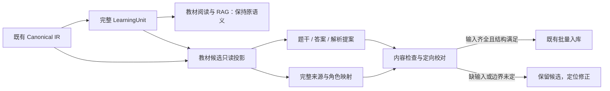

# Projection & Review Design — D-01

2026-10-17 · 设计提案，未实施 / 未作新UI视觉签核。

配套：[字段与生命周期](candidate-contract-specification.md) · [Sol任务与验收](sol-implementation-handoff.md)。

## 1. 投影的位置与边界

修改点在 `memory/textbook_exercise_importer.py::analyze_learning_unit_candidates` 及其私有纯函数。投影器接收同一次加载的Canonical与unit来源；不能再根据unit.text猜回块，更不能二次OCR。提取阶段增加安全source_blocks快照，复用`load_workflow_book`的版本校验。元数据分析在投影之后运行，输入独立题干，防止完整解答污染题型/概念；不扩展通用词表或修改既有去重策略。

**确定性不等于语义真值**：块顺序、span、公式/表格串行化、精确图号唯一定位可以复现；“这段在解释还是提问”“这幅图能否独立提供条件”可能只能提出建议。`block_boundary`表示满足严格结构前提，不是识别准确率。任何同块切分、无标记解答、冲突归属都不得仅因启发式分数高就升级为ready。

## 2. 一次投影的最小步骤

1. 固定请求书/章节/物理页范围及IR逻辑hash。保留原units、text、source_block_ids；对照块按Canonical order排序，保留空图块。
2. 先确认单元结构与候选资格，再按整块角色投影。只接受本域允许的有界邻接补充（见下），不改变全局learning_units结果。
3. 为全部原始块分配 question / answer / explanation / context / unassigned；角色不明时保留原完整材料为可编辑提案，并给出content issue，不伪造“已完成分离”。
4. 生成现有三正文槽；显示包装来自块类型，原文/公式token不改变。检查投影字符/结构覆盖与依赖，产生typed issues。元数据分析最后执行。
5. 前端展示提案和具体来源；仅有问题的候选出现定向修正操作。提交服务重验结构、版本和确认，不信任前端ready声明。

**有界邻接**：仅同书、同IR、用户已选范围内、同规范章节/section scope。先用已有units成员；需要找被全局边界漏出的“证”段或被误识别为新题的公式块时，最多检视紧邻前后单元/其间块，单个投影的完整来源最多80块、页跨度不超过现有8页安全界限；遇真实下一题、明确heading或范围结束即停。图号查找限已选范围，唯一匹配之外不自动选图。用尽预算/无法判定则unresolved，不截掉剩余内容再标ready。注册表过大时整个分析给出可恢复的缩小范围提示，不输出缺块的伪完整v1响应；不引入后台检索Loop。

### 局部纠正上游分组，不改全局语义

旧IR中 `block_type=formula` 的 `1.0 + x = y` 会被 `_PROBLEM_START` 误当新题（R19）；`证：` 的paragraph_title可能被截在例题外（R16）。仅处理已经传来的unit.text不能修复这两项。

允许候选投影器做以下只读组合：

- R19：若新unit的起始块类型是formula，且处于同scope紧邻前题，按公式连续性作为前题内容提案，记录两个原unit_ids；不得把公式数字当题号。不能确定前题归属时保留为待校对来源，禁止生成“1.0”伪题。
- R16：同scope、紧邻例题的独立“证：”标题及其内容可作为解答候选信号。将额外块注册并映射；它虽不在原unit成员中仍必须可追溯。若后续边界不清，只给待校对提案。
- 不改 `LearningUnit.text`、`learning_units()`、原IR的block type或semantic_role。必须用测试同时验证全局原输出不变与候选局部输出符合合同。这是投影器的局部结构归并，不是另一套教材解析流程。

## 3. 四类来源的行为

### A. 普通无显式答案习题

默认将整个合法习题单元的题干、子问、表格、公式保留。answer/explanation保持空。无缺失/混解/边界信号即whole_unit、ready；不要求每题单击确认。

- C007–012是合法概念题、空标签、无源解、真实重复。空标签留在元数据提示，重复仍跳过。
- C020跨p35–36，两个表格、三个子问不能因为页变或括号编号被截断。
- C021已有公式能正常显示，不能笼统重包所有文本中的LaTeX。
- C066要求学生画图。没有引用某个外部必需图，就不是缺图。

**反例门槛**：解、求解、解集、通解、证明出现在设问中不构成solution_in_stem；无答案不构成missing_input；不按低confidence/空知识点强制LLM修复。

### B. 完整附解例题，块边界清晰

满足全部前提才提出block_boundary：

- 起始是可确认例题/问题块，题干含完整设问；相关表、公式、子问仍在题干区域。
- 解答起始是**独立块的明确角色信号**：已有可靠semantic_role，或独立段/标题整体以解、解答、答案、证明、证的标记开头；同时验证来源块位置、同scope与前后边界。marker只识别角色候选，绝不是字符串截断算法。
- 起点之前没有前例条件/缺图/明显断页；终点在已知同单元范围内，且没有可疑下节标题、另一例或图归属冲突。起点明确但终点不明不能把“后面全部”搬到答案。
- 全部源块已解释其去向，无未分配非空内容。

独立“答案”块放answer；“解/解答/证/证明”过程放explanation。只有独立、明确标出的结果块才放answer，绝不从最后一个公式抽“标准答案”。同块同时含结果与推导时整体放explanation，不复制一份到answer制造双权威。空answer + 非空explanation是有效状态。

C001的三个原始paragraph块分别是题干、解、补充解；因此question=第一块，explanation=后两块，answer可空。C003/C004的题干表格必须保留在解答边界前，不能只取第一段。C004源数值争议单独待人工裁决，不允许投影器改数值。C001–006应逐项验证，不能承诺全部无人工即可入库。

### C. 不确定例题 / 同块混解 / 跨节 / 前例依赖

| 来源案例 | 系统允许的提案 | 禁止的自动动作 | 校对完成依据 |
|---|---|---|---|
| C094没有“解”，后续却有数值推导 | method=unresolved；原块保留unassigned，提示题干与解过程边界待确认 | 推断所有公式都是解、从最后数值造答案 | 用户据源整理题干/解段，能精确选择时保留span；手工改写则诚实标user_edited，补齐必要图/条件，再确认当前版本 |
| C096解在首块内部、依赖前例、吞下一小节 | 保留整块；定位具体混合块、前例与后节线索 | split('解')，去掉后文就称完整 | 用户编辑（能精确跟踪时划分span）；前例参数必须进入独立题干；跨节旁文留context；必要图片未解决仍不入库 |
| C091多页后接另一实例/电流小节 | 明确的题干/部分解可作建议，其余unassigned；boundary_uncertain | 把整个后续小节当解答 | 每个被排除区段在source对照可定位；只移到context而非删除来源 |
| C092后接“误差分析”、C093后接“顶点平衡” | 提示终点不定，显示相关标题块位置 | 因括号数字一律切断，或一律视作子问 | 与R17真实子问负例一起核对；不确定继续待校对 |
| 来源截断或缺页 | 标出截断/缺失位置；不把没有的文字当空白 | 生成缺失条件或从别题默默借用 | 用户明确补输入；无法提供则保留候选 |

S1不要求解决所有复杂例题。可确定的部分可以展示，但入库资格按**整题所有必需输入与未解决问题**判断；一部分分离成功不能覆盖其他缺口。用户自行修改为新的独立问题时，method=user_edited，保留原来源依据并承认不再逐字对应；不能将改写后的问题称作原教材的精确题干。

### D. 图片、公式、表格与前文输入

**图片归属**采用三步：识别明确引用 → 查找同范围的图号/源块/已有资产身份 → 检查唯一性和位置冲突。阅读顺序只是一条线索。bbox邻近、上一活动单元、字面“图”都不能单独证明绑定。

- C031引用图3.60，原图被归到C033。应同时指出C031的required依赖与C033的归属冲突，显示共同源figure block；不能继续把图题当完整图片，也不能因纠正C033就宣称C031可练习。
- C095的图11.8在C096；C097/C098共享图11.9。允许多个候选引用同一教材资产，不能复制/重命名源文件或强行图→题一对一。
- 图11.8/11.9的组合裁图存在人工裁决需求；图号唯一不足以证明裁图包含全部参数。保留identified/uncertain，不能把猜测组合变已绑定。
- 图只用于解析或补充阅读时可reference；题干要求据图计算时required；无法确定时uncertain。仅“含图片”不自动生成缺图问题。

**F3边界**：`backend/api/figures.py:128–163` 已有教材figure查询与图像端点；它们属于教材身份，不是exercise附件合同。S1/S2只保留资源身份、页码、块位置和必要输入提示，复用现有教材入口让用户对照（在已有能力范围内）；不新增题库图像端点、不复制/挂载文件、不把本地path写成可访问URL、不将教材临时blob链接存入题干。必要图片仍无法在正式独立练习中交付的候选暂不入库。F3另案批准后才能扩展embedded/可交付资源语义。此限制详见[既有F3待办](../../qa/r1-r2-post-approval/F3-exercise-images.md)。

**公式显示**只在候选串行化层处理：

- 原 `block_type=formula` 保持块级display，已有合法display wrapper不重复包裹；确有显示缺口的裸块在question或explanation中加独立 `$$...$$`，内层LaTeX token逐字保留；现有预处理已正确保留显示语义者保持正文不变；禁止删 `\\tag` 来避错。
- paragraph中的inline math继续原样；不能看见反斜杠就升级整段为display。矩阵、cases、多行式不可按换行或句号拆题。
- 原始equations与raw block.text保留在来源快照；正文的显示包装不改变源span下标。源式残缺、括号错误、同基线碎片只能标formula_review，不能自动补括号/连等号/改数值。
- C091/C096的9次tag错误与C091/C093/C094的6个未识别公式节点逐项验收。每个问题需记录其现在进入题干、解析或context的去向及可读性，不能删去公式、只测题干或把失败块隐藏在折叠区美化结果。

**表格**优先保留已有完整text表示；需要从结构字段串行化时保留table_header空单元格、table_rows列数/顺序、标题、单位、脚注、合并关系的已知限制。源text与结构表示不一致则待校对，不能挑“看起来正确”的一份。布局能显示不证明OCR数值正确。required表格/公式只有正文完整包含且可读时才embedded。

**前文条件**独立建prior_context依赖。仅“见前例”不是完整输入；用户将必要条件补入题干后可embedded，并保留source span；范围外只能提示用户调整/补充，不能自动扩展检索范围。不引入LLM补全。

## 4. 必要的局部 UI 变化

依据现有 `CandidateReviewWorkspace.tsx:19–89`、[R1/R2最终批准记录](../exercises-production-r1-r2/astra-review-2026-10-17.md)，以及本轮实际查看的保留截图 `artifacts/design/exercises-production-r1-r2/final/1280-source-compare.png`。本轮没有重新运行Electron，不将既有截图当新合同视觉验收。

保留来源→校对→入库三阶段、候选索引＋单文档、宽窗原文双栏/窄窗切换、固定提交栏。只改当前信息与操作，不新增全局侧栏、质量仪表盘、独立Agent页。

| 当前位置 | 最小调整 | 用户看到的结果 |
|---|---|---|
| “需注意”筛选/计数 | 拆为“内容待核对”“题目属性”；重复继续单独过滤。数字按候选计数、集合可重叠，不相加成坏题数 | 空知识点不会淹没缺图、混解问题 |
| 索引单行辅助文字 | 优先一个具体content问题，如“需补图3.60”；无content问题显示题型，不默认“待人工校对” | 正常题无新警报，风险题可定位 |
| 题干/参考答案/解析 | 复用现有ReadingMarkdown和编辑字段；分离提案显示短句“已按来源块分离”；有解析无答案时显示“暂无独立参考答案，解题过程见下方” | 不再把空answer描述成题目缺损；例题有建议分离时解析区域默认展开，便于检查 |
| 原文对照 | 默认定位当前unit完整材料；按块顺序显示页码，选中某条问题时高亮对应块/角色；可切回现有整批提取原文 | 能看为什么分离、哪里被排除；不需遍历整本提取文本 |
| 混解/边界问题旁 | 一条具体提示＋“对照并编辑”，编辑仍是题干/答案/解析文本域；能精确选块时提供局部“移到解析/保留为旁文” | 直接修内容，而非多弹窗点通过 |
| 当前异常题修正后 | 复用编辑区操作位，显示“确认本题结构”；只有该操作生成review。可对具体误报选“此段属于题干/此图非必需”等定向动作 | 确认当前内容版本，不能批量生成108个人工回执 |
| 题目属性折叠区 | 知识点/题型/难度提示移入此区，duplicate继续原skip提示；confidence保留次级、不新增分数 | 元数据问题不挡正常阅读 |
| 固定提交栏 | 显示“可入库N题，另M题待核对”，主操作“确认入库N题”；现有一次整批确认里明确保留M题 | 正常题继续批量；待核对题不丢失，也不假装已导入 |
| 既有批次核对入口 | 在现有核对结果中按需展开每题来源和“系统提案/用户确认（导入时）” | 回执有实际消费者，旧批次显示“未记录结构校对信息” |

“全部”仍指全批次选择；可入库集合是选中集合的显式子集。提交后仅移除服务端确认已保存/已跳过重复的候选，不能沿用removeSelectedCandidates把剩余待核对题一起删除。回执不全/网络结果未知时保留候选和当前锁定策略，先核对批次，禁止自动重发。

### 局部交互序列

**正常题**：选择教材 → 生成whole_unit题干 → 阅读/可选编辑 → 一次批量确认 → 系统提案入库。零逐题确认、零“缺答案”阻断。

**C001式明确分离**：题干与解析分别出现 → 对照高亮三个源块 → 用户可直接批量采用，记system_proposed；如主动点本题确认，才记user_confirmed。若改正文，先清空确认，再允许确认当前版本。

**C096式复杂题**：显示完整材料提案和混合块 → 对照并编辑题干/解析 → 补前例条件、确定后节旁文 → 当前题确认。仍有required图不可交付时继续留候选，不出现可入库状态；不因用户完成一次确认而跳过其他问题。

**C031/C033错图**：分别显示“图3.60已在来源找到，独立练习尚不可读取”和“此附图可能属于另一题” → 对照对应块/物理页 → C033排除无关图后可成为独立文字题（需确认）；C031保留缺输入状态。没有假“图片已修复”。

### 不新增的负担与界面边界

- 不增加每题checkbox式“我已阅读免责声明”，不对94条无答案题强制补答案，不因未识别知识点弹窗。
- `review_kind=system_proposed`不要求常驻警告徽标；只在用户查看来源/回执时说明。普通题不永久加“未经人工核实”横幅。
- source_unknown/legacy提示一次批次身份，同时可定位实际内容问题；不得给108条旧候选统一红灯后声称兼容。
- 辅助信息依赖文本和焦点，不仅颜色；编辑、确认和对照按钮键盘可达。1280×820、1024×768、760×820使用既有折叠/切换规则，不产生永久第三列；长式/表格局部横向滚动，不让全页溢出。

## 5. 内容门槛与人工权限

| 情况 | 自动批量采用 | 人工可解决 | 必须继续保留候选 |
|---|---|---|---|
| 完整普通题，答案空/标签空 | 是 | 可自愿改属性 | 无 |
| 独立解块且角色/终点明确，输入完整 | 是，保持系统提案身份 | 可确认分离 | 无 |
| 模糊后节/同块解/无marker例题 | 否 | 对照编辑、解释块去向、确认当前版本 | 不能说明边界或仍有未分配正文 |
| 必需图已找到但仅有教材来源身份 | 否 | 若图实际非必需，可明确作出判断；不能把必需改为参考规避缺图 | 独立作答仍需要该图，等待F3或真正补全输入 |
| 表格/公式完整嵌入题干 | 是 | 可核对数值/符号 | 源残缺或显示不可读且未修正 |
| 只有源解数值可能有误，题干独立完整 | 非普通自动通过项 | 可确认按来源保留参考解，记录source_checked；不宣称答案真值 | 未核对且无法分清源解和题干冲突 |
| IR换版/找不到来源块 | 否（v1） | 重新分析后再校对 | 不能“确认我看过”绕过版本身份 |
| 题型/难度/知识点提示 | 是 | 可改 | 不构成结构门槛 |

这是一项候选内容合同，不是数学答案验证器。原始PDF不可用时，人工确认也只能针对可见OCR材料；源数值、图中参数、跨块原式关系仍须领域审阅者或原PDF支持，不能把校对点击统计当教材准确率。
